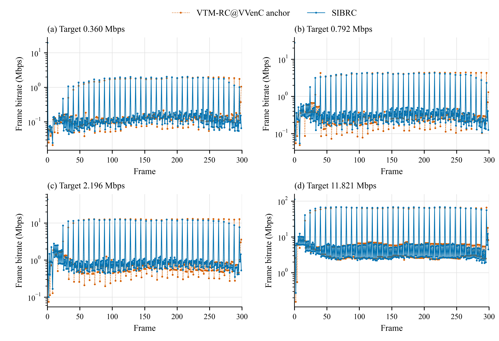
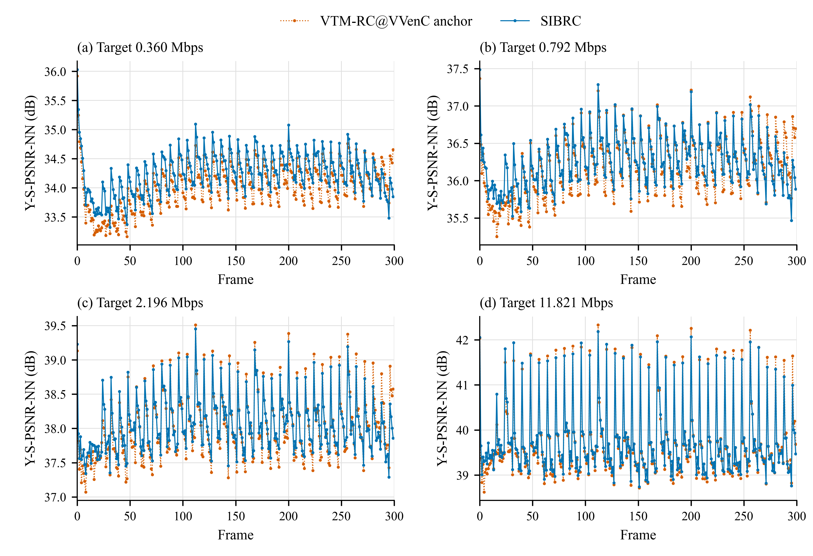

# AerialCity ERP 300-frame three-metric evaluation

Existing frozen VTM-RC@VVenC anchor versus SIBRC full I/P streams. ERP 3840x1920, 30 fps, LDP, VVenC 1.12.0 vvencFFapp faster, serial CTU feedback, QPA off. Four targets from native CQP 37/32/27/22. No re-encoding. All eight reconstructions match the previous full coded-prefix SHA256; ordinary Y/WS per-picture arrays are unchanged.

WS-PSNR, S-PSNR-NN and CPP-PSNR are now project defaults. All reported PSNRs are luma. S/CPP call the original project 360Lib directly, with 655362 sphere points, source8/reconstruction10 and CPP 3840x1920, Lanczos3 luma/Lanczos2 chroma. Qualities are arithmetic means of 300 per-picture dB values. This CPP definition includes 360Lib integer rounding and clipping at each projection bit depth; do not mix it with old bilinear error-plane approximations.

S-PSNR geometry metadata is explicitly initialized through the original initCFSPSNR interface. At the lowest target, all 300 S-PSNR values were recomputed after this initialization correction; the independent CPP results were retained and checked for exact equality against fresh corrected evaluations at frames 0, 150 and 299. The other six streams use the corrected evaluator for both metrics. Separate executable hashes preserve this provenance.

| Metric | SIBRC BD-rate vs anchor |
|---|---:|
| WS-PSNR | -4.3970% |
| S-PSNR-NN | -4.2841% |
| CPP-PSNR | -4.3232% |
| ordinary Y-PSNR | +4.6872% |

Negative BD-rate means rate saving. Actual complete Annex-B rate, common-quality-range PCHIP log-rate integration, no extrapolation. One content sequence: these results describe this experiment.

| Target Mbps | Metric | Anchor dB | SIBRC dB | Delta dB |
|---:|---|---:|---:|---:|
| 0.359510 | WS | 34.018219 | 34.254527 | +0.236308 |
| 0.359510 | S-NN | 34.011574 | 34.245040 | +0.233466 |
| 0.359510 | CPP | 34.173580 | 34.421893 | +0.248313 |
| 0.792057 | WS | 36.182472 | 36.258105 | +0.075633 |
| 0.792057 | S-NN | 36.176428 | 36.251158 | +0.074730 |
| 0.792057 | CPP | 36.469059 | 36.551024 | +0.081965 |
| 2.196112 | WS | 38.015734 | 38.068447 | +0.052713 |
| 2.196112 | S-NN | 38.012157 | 38.063372 | +0.051215 |
| 2.196112 | CPP | 38.482637 | 38.538325 | +0.055688 |
| 11.820750 | WS | 39.702385 | 39.747796 | +0.045411 |
| 11.820750 | S-NN | 39.702008 | 39.744009 | +0.042001 |
| 11.820750 | CPP | 40.373808 | 40.423999 | +0.050191 |

## Per-frame plots

All frames 0..299 are included, with no smoothing. Encoder POC bits sum exactly to full Annex-B size for all eight streams. Frame bitrate = POC bits times 30 fps. The logarithmic bitrate axis preserves the first I-frame peak and subsequent P-frame variations.

Vector PDF/SVG and 600-dpi PNG exports accompany both figures; grayscale previews and layout audits are retained. `frames.csv` contains 2400 rows (300 frames x 4 targets x 2 methods) and all four per-picture quality values. `protocol.json` hashes metric sources, library, executable and sphere data.

Evaluation uses two C-disk temporary reconstructions and an SSD source cache whose 300-frame prefix SHA256 equals the original sequence, to avoid I-disk contention. The cancelled I-disk pilot and recovered metric attempts are excluded from coding time comparisons. Temporary reconstruction files are removed only after full size/hash checks.
